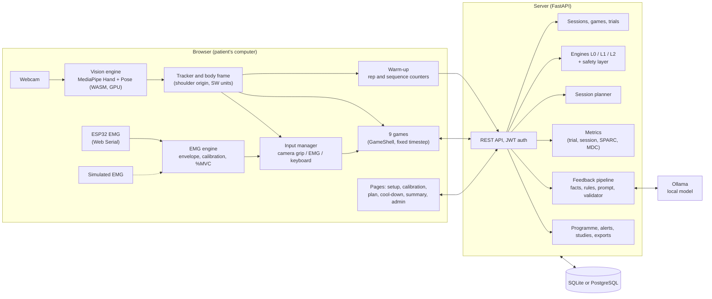
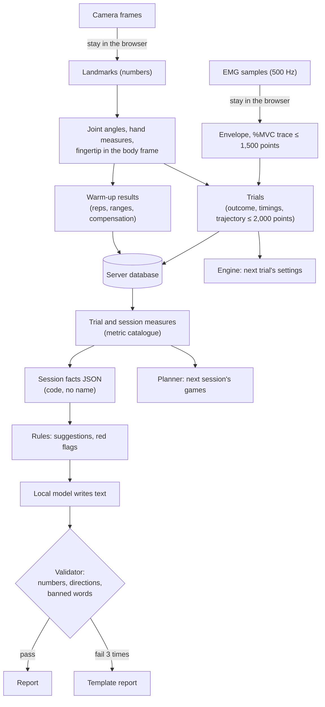
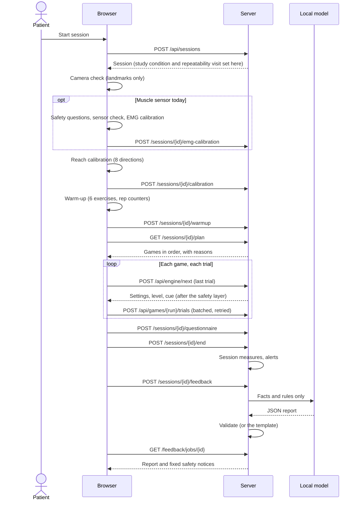

# Architecture

MuVi Rehab is a research prototype for home upper-limb rehabilitation after stroke, not a medical device. It has three parts:

- **The browser app:** React and TypeScript. It does all the sensing.
- **The server:** FastAPI with SQLModel and SQLite. It keeps the data, adapts the difficulty and writes the feedback.
- **A local language model:** Ollama, for the feedback text.

## Components

**Where the code is:**

| Part                                          | Code                   |
| --------------------------------------------- | ---------------------- |
| Vision engine                                 | `web/src/vision/`      |
| Warm-up                                       | `web/src/warmup/`      |
| Games                                         | `web/src/games/`       |
| Input sources                                 | `web/src/input/`       |
| EMG                                           | `web/src/emg/`         |
| Server routes                                 | `server/app/api/`      |
| Engines and safety                            | `server/app/engine/`   |
| Services (planner, metrics, alerts, studies…) | `server/app/services/` |
| Feedback                                      | `server/app/feedback/` |
| Firmware                                      | `firmware/`            |

## Data flow

## A session

## Privacy

- **Video never leaves the browser.** MediaPipe runs in the page. Only landmark-derived numbers are sent: angles, positions in shoulder widths, outcomes and timings. The end-to-end privacy test checks every request of a whole session (`web/e2e/privacy.spec.ts`).
- **EMG is stored only as numbers:**
  - the calibration;
  - per-trial measures;
  - a capped %MVC trace.
- **The language model is local** (Ollama). It gets only the session's facts JSON: a patient code, no name or email.
- **Exports are pseudonymous** (patient codes). Research consent is recorded with its date.
- **Fonts:** the web fonts load from Google Fonts. No session data is sent with them ([security.md](security.md)).

## Safety

- **A safety layer after every engine decision** (`server/app/engine/safety.py`). It sets hard bounds and the therapist's caps, and responds to:
  - compensation;
  - repeated failure;
  - tiring;
  - the session's length.

  The engine cannot override it.

- **The therapist's programme** (`services/programme.py`) limits:
  - the games and the highest level of each;
  - the session's length;
  - how often to rest;
  - the warm-up's targets.
- **The muscle sensor:** safety questions (charger unplugged, fresh batteries) must be answered before the sensor is used. A lost signal falls back to the camera.
- **Feedback text:**
  - it is checked against the facts;
  - medical words are banned;
  - red flags (pain, new symptoms) add fixed safety notices the model cannot change;
  - a failed check falls back to a template.
- **Alerts:** pain, new symptoms and sharp declines raise alerts for the therapist (`services/alerts.py`).
- **Not a medical device:** no diagnosis, no treatment decisions.

## Testing

Unit, integration and end-to-end tests use a replayed camera, a simulated sensor and a mock model; there are also performance, security and validation tools. See [testing.md](testing.md), [performance.md](performance.md), [security.md](security.md) and [validation.md](validation.md).
