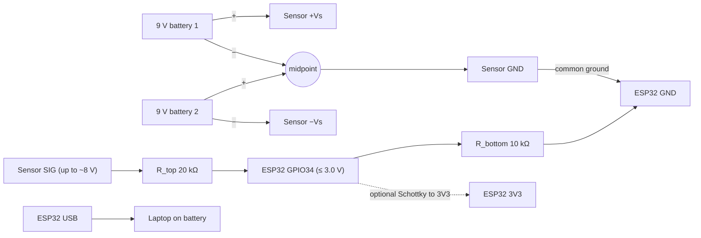

# Hardware day (Day 21): EMG runbook

Everything in the browser is already tested without hardware: a mock ESP32 plays the firmware's protocol through the same code (`web/src/emg/hardwarePath.test.ts`). Today is wiring, flashing and tuning only. The full wiring guide is in [firmware/README.md](../firmware/README.md).

> **SAFETY, before any electrode touches skin:**
> 1. **The laptop runs on battery, with its charger unplugged**, the whole time electrodes are on.
> 2. **The sensor runs on the two 9 V batteries only.** Nothing in the circuit connects to mains.
> 3. **No battery on the ESP32, and never SIG straight into GPIO34** (the pin is damaged above about 3.6 V).
> 4. Remove the electrodes before plugging the charger back in. Disconnect the batteries when finished.

## Parts

- **Sensor:** Muscle Sensor V3.0 (one channel, three snap electrodes, envelope output) and fresh gel electrodes.
- **Power:** two 9 V batteries (each above about 7 V) with snap clips.
- **Board:** ESP32 DevKit V1, USB **data** cable.
- **Divider:** resistors 20 kΩ (top) and 10 kΩ (bottom); optional Schottky clamp (BAT85 or 1N5817).
- **Tools:** breadboard, jumpers, multimeter, alcohol wipes, skin-safe marker.

## Wiring

**The divider:** ratio 10 / (20 + 10) = 0.33, so 8 V at SIG becomes 2.7 V at GPIO34. Measure V_max at SIG during the strongest squeeze before connecting GPIO34. Keep R_bottom / (R_top + R_bottom) ≤ 3.0 / V_max, and check GPIO34 stays at or below 3.0 V.

## Electrodes

| Site | Where | Drives |
| --- | --- | --- |
| **Flexors** | Inner forearm, one third from elbow to wrist, on the muscle belly (feel it bulge in a fist) | Grip |
| **Extensors** | Outer forearm, same distance, on the belly (lift the fingers back) | Hand opening |

- **Placing them:** mid-muscle electrode on the belly; end electrode 2–3 cm towards the wrist, in line; **reference on the bony point of the elbow**.
- **Before:** clean the skin with alcohol and let it dry.
- **After:** take a photo and mark the spots.

## Step order

1. **Flash:** open `firmware/emg_stream/emg_stream.ino` in the Arduino IDE (board "ESP32 Dev Module") and upload. If it does not start uploading, hold **BOOT**.
2. **Serial Monitor:** set **230400 baud**, line ending **Newline**.
   - Press EN/RESET: you should see `I,version=1.0.0,rate=500,mode=ADC,streaming=0,…`.
   - `PING` gives `PONG,1.0.0`; `INFO` prints the settings again.
   - **Close the Serial Monitor afterwards:** only one program can use the port.
3. **SIM ON in the app:**
   - Open `npm run dev`, then <http://localhost:5173/dev/emg-monitor> in Chrome or Edge, and click **Connect ESP32**.
   - Press **SIM ON**: the **Board simulation** badge appears and a 4 s squeeze cycle plots.
   - Press **SIM OFF**.
4. **Rate check:** disconnect in the page first, then run `server\.venv\Scripts\python.exe analysis\tools\serial_rate.py --port COM5 --seconds 60`. You need about 500/s, 0 gaps and 0 firmware drops.
5. **Electrodes on:** only after the SAFETY list above.
6. **/dev/emg-monitor:** reconnect. Relaxed, the envelope should be flat and low; a squeeze should rise clearly, staying below the dashed saturation line. Tune the gain potentiometer if needed.
7. **Readiness:**
   - All 8 steady items must be green for 2 s.
   - Then press **Test squeeze**: "Ready for calibration".
8. **Calibration:** start a patient session, pass the camera check, and do the EMG step (rest 10 s, then 3 maximum efforts).
9. **EMG game:** play Grip and hold (flexors) or Bloom (extensors). The level should follow the squeeze. Pull the USB cable: "Muscle sensor paused — using the camera". Plug it back in: the sensor takes over again.
10. **Recordings:** on `/dev/emg-monitor`, label each recording (person-site-gain) and press **Record 30 s CSV**: 10 s relaxed, then squeeze on each prompt. Make at least 3 per site. They are saved to `analysis/emg/recordings/`.
11. **Results:** run `server\.venv\Scripts\python.exe analysis\emg\emg_validation.py`. It fills the EMG table in [validation.md](validation.md). Then fill the remaining rows of [emg-hardware-test.md](emg-hardware-test.md).

Thresholds can be tuned on **Admin → System → EMG settings** (defaults, limits, and a reset). Note every change in the hardware-test log.

## Troubleshooting by readiness item

| Item (red) | Likely cause | What to do |
| --- | --- | --- |
| 1 Web Serial | Not Chrome or Edge, or not `localhost` | Use Chrome or Edge at `http://localhost:5173` (or 8080) |
| 2 Connected | Port busy or no driver | Close the Serial Monitor and `serial_rate.py`; install the CP210x or CH340 driver; use a data cable |
| 3 Responding (PONG within 2 s) | Wrong firmware, wrong baud, or a board still booting | Re-flash; check `PING` in the Serial Monitor at 230400; press **PING** again after 2 s |
| 4 Rate 490–510/s | `RATE` was changed, or the board is overloaded | Send `RATE 500`; check `INFO`; run `serial_rate.py` |
| 5 Gaps < 0.5 % | USB hub, a busy laptop, or a bad cable | Use a direct USB port; close heavy programs; change the cable; check `dropped` in the S lines |
| 6 Contact (SD > 2 mV) | Flat line: an electrode is off, the batteries are flat, or SIG is not wired | Press the electrodes on; check both batteries > 7 V; check SIG → divider → GPIO34 and the common ground; `SIM ON` should still move |
| 7 Saturation (< 3000 mV) | Gain too high, or the divider is wrong | Turn the gain down; re-measure V_max; check GPIO34 ≤ 3.0 V at the strongest squeeze |
| 8 Relaxed (SD ≤ 40, mean ≤ 800 mV) | Not relaxed, the arm unsupported, mains noise, or an electrode lifting | Rest the forearm on the table; unplug the charger; fresh electrodes; reference on the bony elbow |
| 9 Test squeeze (≥ 3 × relaxed, with an onset) | Electrodes off the muscle belly, the wrong site, or gain too low | Move to the belly (feel the bulge); check the site matches (flexors: squeeze; extensors: open); turn the gain up a little |
