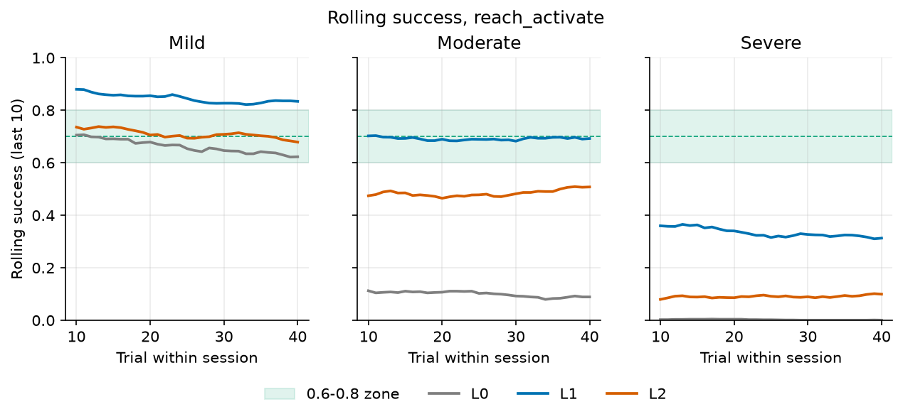
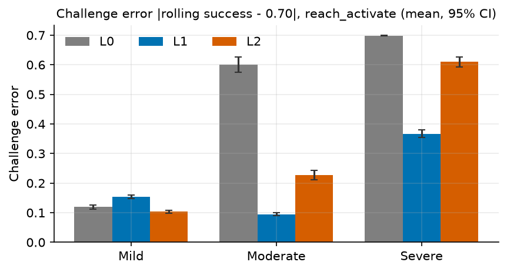
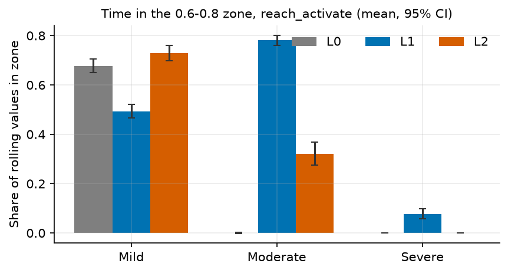
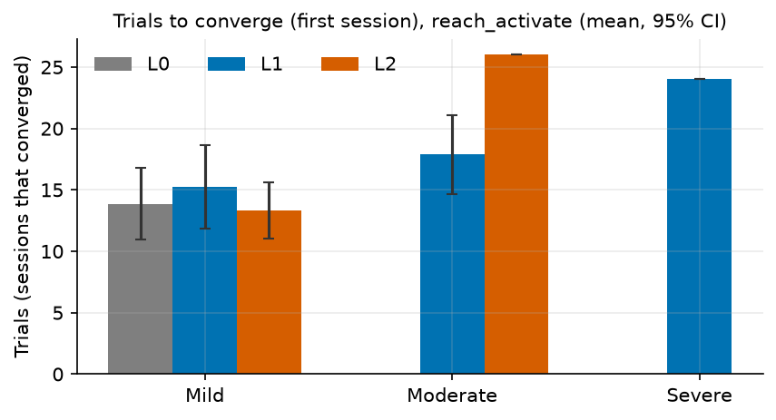
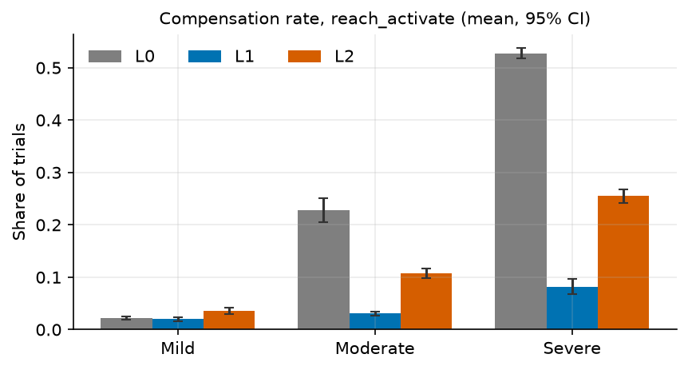
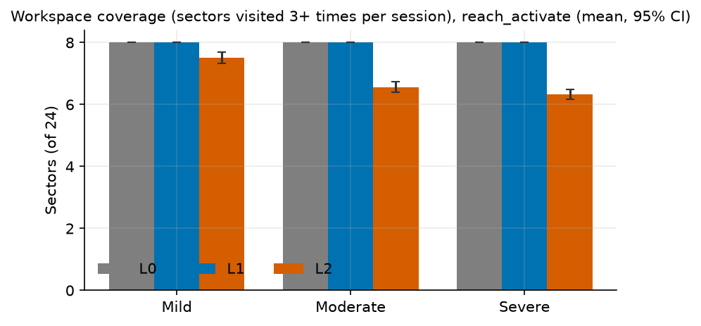
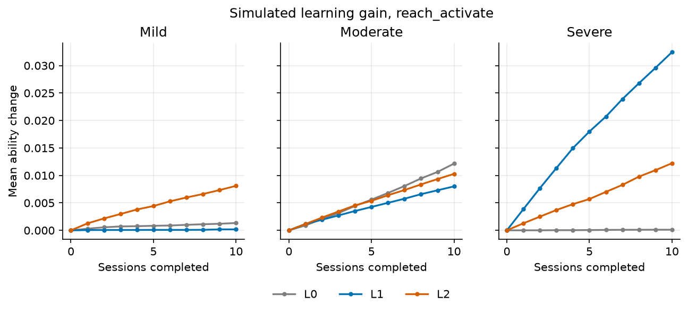
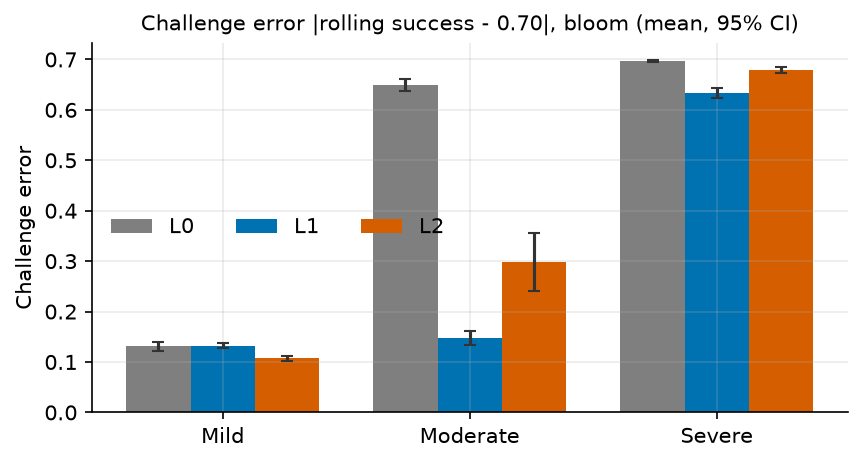
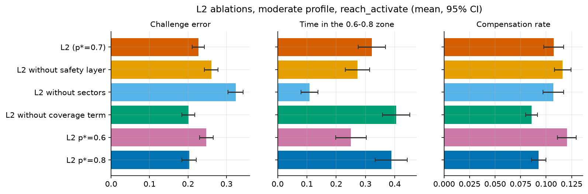

# Simulation results: L0, L1 and L2

> **Quick run** (20 patients per group). These numbers are only for checking the pipeline; regenerate this page with the full run (see Reproducing).

These results describe how the difficulty engines behave on a *model* of a patient. They are not evidence of clinical effect.

## Method

- **Simulator** (`server/app/engine/sim/`):
  - Each simulated patient has abilities on the same scale as the demands they meet:
    - reach per direction (a fraction of the calibrated reach);
    - activation (0–1);
    - speed and precision (0–1, against the difficulty d of those settings).
  - Each component succeeds with p = 1 / (1 + e^(−k (ability − demand))), k = 8 (k = 12 for activation). A trial succeeds when every component the game uses succeeds; the first to fail names the failure, as the browser does.
  - Fatigue within a session multiplies every ability by 1 − f (1 − e^(−t/τ)), f 0.05–0.3, τ about 60 trials; a rest cue halves t.
  - Learning between sessions: each ability rises by η (0.001–0.003) per success near its edge, capped at 1.
  - Compensation becomes likely beyond the reach in a direction.
- **Same code as the app:** the simulator runs the server's real engines and safety layer through the same function as `POST /api/engine/next`; a test replays a simulated session through the API and gets identical decisions.
- **Profiles:**

  | Profile | Reach (fraction of calibrated reach) | Activation | Speed, precision |
  | --- | --- | --- | --- |
  | Mild | 0.85–1.0 | 0.70 | 0.70 |
  | Moderate | 0.55–0.8, two weak directions 0.35–0.5 | 0.45 | 0.50 |
  | Severe | 0.3–0.5 | 0.25 | 0.30 |

  Activation, speed and precision vary ±0.05 between patients.
- **Design:** 20 patients per profile and engine, 10 sessions × 40 trials of Reach and squeeze (`reach_activate`, a spatial game with directions); 20 patients of Bloom (`bloom`, no directions). Within a profile every engine meets the same simulated patients (fixed seeds).
- **Engines:** L0 keeps the admin's defaults; L1 is the 2-up/1-down staircase; L2 is the Bayesian, workspace-aware engine (see [the engine](ai-engine.md)).
- **Measures** (per session, then averaged per patient):
  - rolling success over 10 trials;
  - challenge error: the mean |rolling success − 0.70|;
  - time in the 0.6–0.8 zone;
  - trials to converge: the first trial after which rolling success stays in the zone for 10 trials, in the first session;
  - compensation rate;
  - workspace coverage: sectors (8 directions × 3 rings) visited at least 3 times;
  - learning gain: the mean ability change from the first to the last session.
- **Statistics:**
  - per profile, Kruskal–Wallis across the three engines;
  - pairwise Mann–Whitney U, Holm-corrected over the three pairs;
  - rank-biserial effect sizes r (positive when the first engine's values tend to be larger);
  - 95% confidence intervals of the mean from the t distribution.

## Results: Reach and squeeze

Mean [95% CI] per patient. Trials to converge is the mean over the patients whose first session converged (n of them).

| Profile | Engine | Success rate | Challenge error | Time in the 0.6-0.8 zone | Trials to converge | Compensation rate | Workspace coverage | Simulated learning gain |
| --- | --- | --- | --- | --- | --- | --- | --- | --- |
| Mild | L0 | 0.663 [0.648, 0.679] | 0.120 [0.113, 0.126] | 0.677 [0.649, 0.705] | 13.9 [11.0, 16.8] (n=16) | 0.022 [0.019, 0.026] | 8.0 [8.0, 8.0] | 0.0013 [0.0004, 0.0023] |
| Mild | L1 | 0.849 [0.843, 0.855] | 0.154 [0.148, 0.160] | 0.494 [0.467, 0.520] | 15.2 [11.8, 18.6] (n=18) | 0.020 [0.016, 0.024] | 8.0 [8.0, 8.0] | 0.0002 [-0.0000, 0.0004] |
| Mild | L2 | 0.707 [0.697, 0.718] | 0.103 [0.098, 0.109] | 0.730 [0.699, 0.761] | 13.3 [11.1, 15.6] (n=15) | 0.036 [0.030, 0.042] | 7.5 [7.3, 7.7] | 0.0081 [0.0067, 0.0095] |
| Moderate | L0 | 0.100 [0.075, 0.125] | 0.600 [0.575, 0.625] | 0.001 [-0.001, 0.004] | – | 0.228 [0.205, 0.251] | 8.0 [8.0, 8.0] | 0.0122 [0.0090, 0.0153] |
| Moderate | L1 | 0.692 [0.675, 0.709] | 0.094 [0.090, 0.099] | 0.781 [0.760, 0.802] | 17.9 [14.7, 21.1] (n=17) | 0.031 [0.027, 0.035] | 8.0 [8.0, 8.0] | 0.0080 [0.0070, 0.0090] |
| Moderate | L2 | 0.482 [0.461, 0.504] | 0.227 [0.210, 0.243] | 0.322 [0.276, 0.368] | 26.0 [–, –] (n=1) | 0.107 [0.098, 0.117] | 6.6 [6.4, 6.7] | 0.0103 [0.0089, 0.0116] |
| Severe | L0 | 0.002 [0.001, 0.003] | 0.698 [0.697, 0.699] | 0.000 [0.000, 0.000] | – | 0.527 [0.517, 0.537] | 8.0 [8.0, 8.0] | 0.0001 [0.0000, 0.0002] |
| Severe | L1 | 0.335 [0.321, 0.350] | 0.367 [0.354, 0.381] | 0.078 [0.057, 0.098] | 24.0 [–, –] (n=1) | 0.082 [0.067, 0.097] | 8.0 [8.0, 8.0] | 0.0325 [0.0285, 0.0364] |
| Severe | L2 | 0.089 [0.073, 0.104] | 0.610 [0.594, 0.626] | 0.000 [0.000, 0.000] | – | 0.255 [0.242, 0.268] | 6.3 [6.2, 6.5] | 0.0122 [0.0098, 0.0146] |



*Rolling success within a session; the 0.6–0.8 zone is shaded.*



*Challenge error (lower is better).*



*Time in the 0.6–0.8 zone (higher is better).*



*Trials to converge in the first session (patients whose session converged).*



*Compensation rate (lower is better).*



*Workspace coverage.*



*Simulated learning gain across sessions.*

### Engine comparisons (challenge error)

r is positive when the first engine of the pair tends to have the larger challenge error.

| Profile | Kruskal–Wallis p | Pair | Holm p | Rank-biserial r |
| --- | --- | --- | --- | --- |
| Mild | <0.001 | L0 vs L1 | <0.001 | -0.92 |
| Mild | <0.001 | L0 vs L2 | <0.001 | 0.62 |
| Mild | <0.001 | L1 vs L2 | <0.001 | 1.00 |
| Moderate | <0.001 | L0 vs L1 | <0.001 | 1.00 |
| Moderate | <0.001 | L0 vs L2 | <0.001 | 1.00 |
| Moderate | <0.001 | L1 vs L2 | <0.001 | -1.00 |
| Severe | <0.001 | L0 vs L1 | <0.001 | 1.00 |
| Severe | <0.001 | L0 vs L2 | <0.001 | 1.00 |
| Severe | <0.001 | L1 vs L2 | <0.001 | -1.00 |

Every measure's tests are in `stats.csv`.

## Results: Bloom (no directions)

| Profile | Engine | Success rate | Challenge error | Time in zone |
| --- | --- | --- | --- | --- |
| Mild | L0 | 0.723 [0.706, 0.740] | 0.131 [0.122, 0.140] | 0.628 [0.591, 0.665] |
| Mild | L1 | 0.820 [0.816, 0.825] | 0.132 [0.127, 0.137] | 0.597 [0.570, 0.623] |
| Mild | L2 | 0.705 [0.695, 0.715] | 0.107 [0.102, 0.112] | 0.728 [0.707, 0.749] |
| Moderate | L0 | 0.053 [0.042, 0.065] | 0.649 [0.637, 0.661] | 0.000 [0.000, 0.000] |
| Moderate | L1 | 0.667 [0.635, 0.699] | 0.148 [0.135, 0.162] | 0.606 [0.570, 0.642] |
| Moderate | L2 | 0.422 [0.357, 0.488] | 0.298 [0.241, 0.355] | 0.302 [0.206, 0.398] |
| Severe | L0 | 0.003 [0.002, 0.005] | 0.697 [0.695, 0.698] | 0.000 [0.000, 0.000] |
| Severe | L1 | 0.065 [0.055, 0.075] | 0.634 [0.624, 0.644] | 0.000 [-0.000, 0.000] |
| Severe | L2 | 0.021 [0.015, 0.026] | 0.679 [0.674, 0.685] | 0.000 [0.000, 0.000] |



## Ablations of L2 (moderate profile, Reach and squeeze)

| Variant | Success rate | Challenge error | Time in zone | Compensation | Coverage |
| --- | --- | --- | --- | --- | --- |
| L2 (p*=0.7) | 0.482 [0.461, 0.504] | 0.227 [0.210, 0.243] | 0.322 [0.276, 0.368] | 0.107 [0.098, 0.117] | 6.6 [6.4, 6.7] |
| L2 without safety layer | 0.450 [0.428, 0.471] | 0.260 [0.242, 0.278] | 0.273 [0.231, 0.314] | 0.116 [0.108, 0.124] | 6.5 [6.3, 6.6] |
| L2 without sectors | 0.376 [0.357, 0.394] | 0.324 [0.304, 0.344] | 0.109 [0.080, 0.137] | 0.107 [0.097, 0.117] | 7.3 [7.2, 7.5] |
| L2 without coverage term | 0.512 [0.495, 0.530] | 0.201 [0.184, 0.218] | 0.405 [0.358, 0.451] | 0.086 [0.080, 0.092] | 5.8 [5.6, 5.9] |
| L2 p*=0.6 | 0.456 [0.437, 0.475] | 0.247 [0.230, 0.265] | 0.250 [0.198, 0.302] | 0.120 [0.111, 0.130] | 6.8 [6.6, 7.0] |
| L2 p*=0.8 | 0.514 [0.492, 0.537] | 0.203 [0.184, 0.221] | 0.388 [0.334, 0.443] | 0.093 [0.086, 0.100] | 6.1 [5.8, 6.3] |



## Interpretation

- **Mild:** L2's challenge error (0.103) was lower than L1's (0.154; Holm p <0.001, rank-biserial r for L2 against L1 -1.00).
- **Moderate:** L2's challenge error (0.227) was higher than L1's (0.094; Holm p <0.001, rank-biserial r for L2 against L1 1.00).
- **Severe:** L2's challenge error (0.610) was higher than L1's (0.367; Holm p <0.001, rank-biserial r for L2 against L1 1.00).

**L2 was not better than L1 on challenge error in every profile.** Likely reasons:

- **Exploration cost:** L2 keeps an independent belief for each of 24–32 sectors. With 40-trial sessions most far sectors get less than one trial per session, so their beliefs stay close to the priors and L2 keeps exploring targets the patient fails.
- **Forgetting:** 30% of what was learned drifts back to the prior between sessions, which slows convergence further for rarely visited sectors.
- **Credit assignment:** a trial succeeds only when every part does. L2 aims each part at 0.70^(1/k) and shares an ambiguous reach failure between the sector and the precision level; both are approximations of the joint outcome.
- **Optimistic priors** for the outer rings (R2 3:2, R3 2:2) suit mild patients but not moderate or severe ones, whose reach rarely meets them; without a calibration or warm-up (not simulated here) nothing corrects them early.
- **The simulator's assumptions:** independent logistic components, a fixed floor of 0.40 for the easiest distance and no between-direction learning transfer all favour a single global staircase such as L1.

Possible next steps, not tested here: share evidence between neighbouring sectors (a hierarchical prior), start from the calibration and warm-up, and reconsider the coverage term in the light of the ablations.

L0 keeps the admin's defaults, so its success depends only on how well they fit the profile. Results are from simulated patients and do not show clinical effect.

## Reproducing

```powershell
server\.venv\Scripts\python.exe -m pip install -r analysis\requirements.txt
server\.venv\Scripts\python.exe analysis\run_simulation.py --doc docs\simulation-results.md
```

Outputs go to `analysis/results/simulation/`: `results.csv`, `summary.csv`, `stats.csv`, `ablation_results.csv`, `ablation_summary.csv` and `figures/`. This run took 0.5 minutes.
